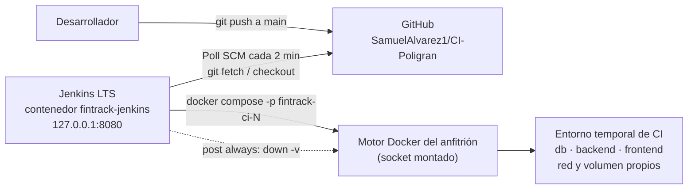

# Informe técnico – Entrega 2: Jenkins e integración continua en FinTrack

Documento de referencia para redactar el informe académico. Contiene el estado real verificado; lo que no se ejecutó está marcado como pendiente.

**Estados usados:** EXITOSO · FALLIDO · PENDIENTE DE EJECUCIÓN · PENDIENTE DE CONFIGURACIÓN MANUAL · NO APLICA.

---

## 1. Información general

| Campo | Valor |
| --- | --- |
| Proyecto | FinTrack (demostración de integración continua) |
| Asignatura | Integración Continua, Ingeniería de Software (virtual), Politécnico Grancolombiano |
| Estudiante | Samuel Alvarez Ospina |
| Entrega | Entrega 2 – Escenario 5 |
| Fecha | 24 de noviembre de 2026 |
| Repositorio | https://github.com/SamuelAlvarez1/CI-Poligran |
| Rama de trabajo | `ci/jenkins-integracion-continua` (creada desde `main` en `0c4ad77`) |
| Estado de `main` | Sin cambios; sincronizada con `origin/main` |

### 1.1 Objetivo de la segunda entrega

Incorporar Jenkins al proyecto FinTrack para automatizar las operaciones de integración continua (instalación, pruebas, compilación, construcción de imágenes e integración) y demostrarlo con evidencias reales. No se agregaron funcionalidades de finanzas personales.

### 1.2 Estado inicial del proyecto (contrastado con el repositorio)

- Aplicación en `fintrack-integracion-continua/` (no en la raíz del repositorio).
- Tres servicios Compose en `compose.yaml`: `db` (`fintrack-db`), `backend` (`fintrack-backend`) y `frontend` (`fintrack-frontend`), con nombres de contenedor, puertos (3000 y 5173) y volumen (`fintrack-db`) fijos.
- Backend NestJS 11 con Prisma 6 y migración inicial `20261110160000_init`.
- Prueba automática: 6 pruebas en `calculate-summary.test.ts` (4 de resumen financiero y 2 de monto positivo).
- Endpoint `GET /api/health`, que responde `{"status":"ok","service":"fintrack-api","database":"up"}`.
- `git status`: solo `.DS_Store` sin rastrear en la raíz.
- Remoto: `origin` = `https://github.com/SamuelAlvarez1/CI-Poligran.git`; rama principal `main`.

### 1.3 Alcance implementado

- Infraestructura de Jenkins en Docker, separada de FinTrack (`jenkins/`).
- Entorno aislado de integración (`fintrack-integracion-continua/compose.ci.yaml`).
- Pipeline declarativo de nueve etapas (`Jenkinsfile`) con `Poll SCM`.
- Script de integración (`fintrack-integracion-continua/scripts/integration-test.sh`) y verificación de API (`scripts/integration-check.js`).
- Script `test:ci` con reporte JUnit en el backend.
- Documentación: sección nueva en el README de la aplicación, esta guía de evidencias y este informe.

**No incluido:** Travis CI, Codeship, Kubernetes, webhooks públicos ni túneles. No se hicieron publicaciones (`push`) ni cambios en GitHub.

### 1.4 Tecnologías y versiones reales

| Herramienta | Versión | Dónde se obtuvo |
| --- | --- | --- |
| Jenkins | 2.580.2 LTS | `jenkins/jenkins:lts-jdk21`, verificado con `jenkins.war --version` |
| Java (JDK) | OpenJDK 21.0.13 | Dentro del contenedor Jenkins |
| Node.js (imagen Jenkins) | v22.23.5 | Copiado de `node:22-bookworm-slim` |
| npm (imagen Jenkins) | 10.9.9 | Igual que arriba |
| Docker CLI (imagen Jenkins) | 29.9.3 | Binario estático de download.docker.com |
| Docker Compose (imagen Jenkins) | v5.7.0 | Binario de GitHub releases |
| Node.js (anfitrión, pruebas locales) | v26.13.0 | `node -v` en el equipo |
| npm (anfitrión) | 11.20.0 | `npm -v` en el equipo |
| Docker Desktop (anfitrión) | 29.9.3 (Server) | `docker --version` |
| Docker Compose (anfitrión) | v5.7.0 | `docker compose version` |
| PostgreSQL | 16-alpine | Imagen `postgres:16-alpine` |
| Equipo | macOS (Darwin 27.2.0), arquitectura arm64 (Apple Silicon) | `uname -a` |

Plugins de Jenkins instalados en la imagen con `jenkins-plugin-cli`: `git`, `workflow-aggregator` (Pipeline), `pipeline-stage-view` y `junit`. El núcleo de Jenkins incluye Credentials.

### 1.5 Requisitos técnicos y del entorno

- Docker con Compose v2 en ejecución.
- Puerto 8080 libre en `127.0.0.1`.
- Acceso de salida a `download.docker.com`, `github.com` (binario de Compose y repositorio), `registry-1.docker.io` (imágenes) y `binaries.prisma.sh` (motores de Prisma durante `npm ci`).
- Repositorio público en GitHub (no requiere credenciales para `Poll SCM` ni para el checkout).

---

## 2. Arquitectura

### 2.1 Arquitectura anterior

Tres servicios Compose (`db`, `backend`, `frontend`) con nombres fijos, puertos publicados 3000 y 5173, volumen `fintrack-db` y red `fintrack`. El flujo de integración era manual.

### 2.2 Nueva arquitectura



### 2.3 Responsabilidades

| Componente | Responsabilidad |
| --- | --- |
| GitHub | Repositorio de código y fuente de cambios |
| Jenkins (`fintrack-jenkins`) | Detecta cambios, ejecuta el pipeline, publica resultados y artefactos |
| Motor Docker del anfitrión | Construye imágenes y ejecuta el entorno temporal de CI |
| `compose.ci.yaml` | Define el entorno aislado de integración |
| `Jenkinsfile` | Define las nueve etapas, la detección de cambios y la limpieza |
| `scripts/integration-test.sh` | Levanta el entorno, espera healthchecks y ejecuta las verificaciones |
| `scripts/integration-check.js` | Verifica health, movimientos, balance y limpieza mediante la API |

### 2.4 Comunicación entre servicios

- En el entorno de CI, `backend` llega a `db` por el nombre del servicio (`db:5432`, base `fintrack_ci`).
- Las verificaciones se ejecutan **dentro** de los contenedores (`docker compose exec`), por lo que Jenkins no necesita unirse a la red del entorno de CI ni usar puertos del anfitrión.
- El navegador no interviene en la integración automática.

### 2.5 Persistencia de Jenkins

- Volumen Docker `fintrack-jenkins-home` montado en `/var/jenkins_home`. Conserva la configuración, los jobs, los builds y las credenciales.
- `restart: unless-stopped` y la opción `stop` mantienen la configuración entre reinicios.
- `docker compose -f jenkins/compose.yaml down -v` eliminaría esa configuración (irreversible).

### 2.6 Mecanismo de aislamiento de pruebas

| Recurso | Aislamiento aplicado |
| --- | --- |
| Nombre de proyecto | `fintrack-ci-${BUILD_NUMBER}`, único por build |
| Contenedores | Sin `container_name`; Compose les asigna `fintrack-ci-N-<servicio>-1` |
| Puertos | Ninguno publicado al anfitrión |
| Volumen | `ci-db` del proyecto CI; el volumen `fintrack-db` de la aplicación no se usa |
| Red | Red por defecto del proyecto CI; la red `fintrack` de la aplicación no se usa |
| Base de datos | `fintrack_ci` (datos ficticios) |
| Concurrencia | `disableConcurrentBuilds()` y nombre de proyecto distinto por build |
| Limpieza | `down -v --remove-orphans --rmi local` en `post always`. Sin `system prune` ni `volume prune` |

Verificación realizada: tras la limpieza, `docker ps -a`, `docker volume ls` y `docker network ls` filtrados por `fintrack-ci-1` no devolvieron recursos. El volumen `fintrack-db` y la red `fintrack` de la aplicación original seguían existiendo.

---

## 3. Implementación

### 3.1 Archivos creados

| Archivo | Descripción |
| --- | --- |
| `jenkins/Dockerfile` | Imagen de Jenkins con Node 22, Docker CLI, Compose y plugins |
| `jenkins/compose.yaml` | Servicio Jenkins con socket, volumen persistente y puerto local |
| `Jenkinsfile` | Pipeline declarativo de nueve etapas con `pollSCM` |
| `fintrack-integracion-continua/compose.ci.yaml` | Entorno aislado de integración |
| `fintrack-integracion-continua/scripts/integration-test.sh` | Pruebas de integración de nivel contenedor |
| `fintrack-integracion-continua/scripts/integration-check.js` | Verificación de la API y del balance |
| `docs/GUIA_EVIDENCIAS_ENTREGA_2.md` | Guía de 27 evidencias |
| `docs/INFORME_TECNICO_ENTREGA_2.md` | Este informe |

### 3.2 Archivos modificados

| Archivo | Cambio | Motivo |
| --- | --- | --- |
| `fintrack-integracion-continua/backend/package.json` | Script `test:ci` | Ejecutar pruebas no interactivas con reporte JUnit. `test` no cambió |
| `fintrack-integracion-continua/.gitignore` | Agregar `test-results/` y `ci-logs.txt` | Evitar versionar reportes y logs generados |
| `fintrack-integracion-continua/README.md` | Nueva sección "Integración continua con Jenkins" | Documentar la ejecución. La sección de la primera entrega se conservó |

Ningún archivo de la aplicación se modificó en su lógica. No se hicieron refactorizaciones.

### 3.3 Decisiones técnicas

1. **Jenkinsfile en la raíz, aplicación en subcarpeta.** La guía proponía `CI-Poligran/` con `frontend/` y `backend/` directamente. La aplicación está en `fintrack-integracion-continua/`, así que el pipeline usa `APP_DIR` en lugar de mover archivos.
2. **Node.js copiado desde la imagen oficial `node:22-bookworm-slim`.** Evita instalar paquetes manualmente. Se usa la misma versión mayor que los Dockerfile de la aplicación (22).
3. **Docker CLI y Compose como binarios fijados por versión** (`DOCKER_VERSION`, `COMPOSE_VERSION`), no desde paquetes del sistema.
4. **Verificaciones dentro de los contenedores** (`docker compose exec`), sin unir Jenkins a la red de CI ni publicar puertos.
5. **Plugins mínimos.** Se instalaron cuatro. No se usó Docker Pipeline ni GitHub plugin: el pipeline invoca Docker por línea de comandos y el repositorio es público.
6. **`Poll SCM` en lugar de webhook.** Jenkins está en local y no se expone a internet.
7. **Socket Docker del anfitrión.** Da privilegios elevados sobre el motor Docker; se documenta como limitado al entorno académico. Alternativa descartada: Docker-in-Docker, que añade complejidad y un segundo daemon.
8. **Jenkins en `127.0.0.1:8080`**, sin exponer la interfaz a la red local.
9. **No se usó Node de la imagen de Jenkins para `npm test`** en la verificación local; se ejecutó con Node 26 del anfitrión. La versión 22 se verificó dentro de la imagen de Jenkins (`node --version`).

### 3.4 Configuración de Jenkins

- Imagen: `fintrack-jenkins:lts` (Jenkins 2.580.2, JDK 21.0.13).
- Publicación: `127.0.0.1:8080:8080`.
- Socket: `/var/run/docker.sock` montado. Grupo: `group_add: ${DOCKER_GID:-0}`. Verificado: `docker ps` y `docker compose version` funcionan como usuario `jenkins` (uid 1000, grupo 0).
- Estado: contenedor en ejecución; HTTP 200 en `/login`.
- **Configuración inicial del asistente, creación del job y primer build: PENDIENTE DE CONFIGURACIÓN MANUAL.**

### 3.5 Complementos

| Plugin | Estado | Tipo | Uso |
| --- | --- | --- | --- |
| Git (`git`) | Instalado en la imagen | Obligatorio | Checkout |
| Pipeline (`workflow-aggregator`) | Instalado en la imagen | Obligatorio | Ejecución de `Jenkinsfile` |
| Pipeline Stage View (`pipeline-stage-view`) | Instalado en la imagen | Recomendado | Vista de etapas |
| JUnit (`junit`) | Instalado en la imagen | Recomendado | Resultados de pruebas |
| Credentials | Incluido en el núcleo | Incluido | Gestión de credenciales (no se usan credenciales en el pipeline) |

### 3.6 Configuración del pipeline

- Declarativo, `agent any`.
- `options`: `disableConcurrentBuilds()`, `buildDiscarder` con 20 builds, `timeout` de 45 minutos.
- `triggers`: `pollSCM('H/2 * * * *')`.
- `environment`: `APP_DIR=fintrack-integracion-continua` y `CI_PROJECT=fintrack-ci-${BUILD_NUMBER}`.

### 3.7 Etapas

| # | Etapa | Comandos reales | Criterio de fallo |
| --- | --- | --- | --- |
| 1 | Checkout | `checkout scm`, `git rev-parse HEAD` | Error de Git |
| 2 | Validación del entorno | `node --version`, `npm --version`, `git --version`, `docker version`, `docker compose version`, `test -f`, `docker compose config -q` | Herramienta ausente o Compose inválido |
| 3 | Instalar dependencias | `npm ci` en `backend/` y `frontend/` | Lockfile inconsistente o instalación fallida |
| 4 | Pruebas backend | `npm run test:ci` → `junit.xml` | Cualquier prueba fallida |
| 5 | Compilar backend | `npm run build` (`tsc -p tsconfig.build.json`) | Error de TypeScript |
| 6 | Compilar frontend | `npm run build` (`tsc --noEmit && vite build`) | Error de TypeScript o de Vite |
| 7 | Construir imágenes Docker | `docker compose -p fintrack-ci-N -f compose.ci.yaml build` | Error de build |
| 8 | Pruebas de integración | `sh scripts/integration-test.sh` | Servicio no saludable, migración faltante o verificación de API fallida |
| 9 | Resultados y artefactos | Archivar `frontend/dist/**`; registrar `GIT_COMMIT` | No aplica |
| post | Limpieza | `docker compose -p ... down -v --remove-orphans --rmi local` | Se ejecuta siempre |

### 3.8 Detección automática de cambios

`pollSCM('H/2 * * * *')`: Jenkins consulta el repositorio cada dos minutos y, si hay un commit nuevo en la rama configurada, lanza un build. Requiere que el job exista y haya ejecutado al menos una vez para que el disparador quede activo.

Diferencia con webhook: Poll SCM es pull (Jenkins consulta a GitHub) y no requiere conexiones entrantes ni URL pública. El webhook es push (GitHub notifica a Jenkins), es inmediato y requiere una URL accesible desde internet (un túnel o un proxy), además de un secreto compartido y una configuración de entrega en GitHub.

### 3.9 Configuración de seguridad

- Jenkins solo escucha en `127.0.0.1`.
- Asistente de desbloqueo y seguridad de Jenkins sin desactivar.
- Sin credenciales reales en el repositorio. Las credenciales de PostgreSQL en `compose.ci.yaml` y `.env.example` son de demostración.
- Socket Docker: privilegios elevados, documentado.
- `ci-logs.txt` y `test-results/` ignorados por Git.

### 3.10 Comandos reales ejecutados

```bash
# Rama de trabajo
git switch -c ci/jenkins-integracion-continua

# Pruebas y compilación locales (equivalentes a las etapas 4 a 6)
cd fintrack-integracion-continua/backend && npm run test:ci
cd fintrack-integracion-continua/backend && npm run build
cd fintrack-integracion-continua/frontend && npm run build

# Imagen y servicio de Jenkins
docker build -t fintrack-jenkins:lts jenkins/
docker compose -f jenkins/compose.yaml up -d
docker exec fintrack-jenkins docker compose version

# Etapas 2, 7 y 8 con el mismo código del Jenkinsfile
cd fintrack-integracion-continua
export CI_PROJECT=fintrack-ci-1
docker compose -p "$CI_PROJECT" -f compose.ci.yaml config -q
docker compose -p "$CI_PROJECT" -f compose.ci.yaml build
sh scripts/integration-test.sh

# Limpieza (equivalente al post)
docker compose -p "$CI_PROJECT" -f compose.ci.yaml down -v --remove-orphans --rmi local
```

---

## 4. Resultados

### 4.1 Tabla de verificaciones

| Verificación | Comando ejecutado | Resultado esperado | Resultado real | Estado | Observaciones | Evidencia |
| --- | --- | --- | --- | --- | --- | --- |
| Pruebas backend | `npm run test:ci` | Todas exitosas | 6 pruebas, 6 exitosas, 0 fallidas, 0 canceladas | EXITOSO | Ejecutado con Node 26 en el anfitrión | `backend/test-results/junit.xml` (salida local) |
| Compilación backend | `npm run build` | Sin errores TypeScript | Código de salida 0 | EXITOSO | Node 26 en el anfitrión; también compila dentro de la imagen Docker | Figura 15 pendiente de captura desde Jenkins |
| Compilación frontend | `npm run build` | `vite build` completa | Código de salida 0, `✓ built in 518ms`, `dist/` generado | EXITOSO | Node 26 en el anfitrión | Figura 16 pendiente |
| Configuración Compose CI | `docker compose -p fintrack-ci-1 -f compose.ci.yaml config -q` | Sin errores | `CONFIG_OK` | EXITOSO | | |
| Construcción de imágenes | `docker compose ... build` | Imágenes `fintrack-ci-1-backend` y `-frontend` | `Built` para ambas | EXITOSO | Node 22 dentro de la imagen | Figura 17 pendiente |
| Arranque y healthchecks | `docker compose ... up -d --wait` | db, backend y frontend `healthy` | Los tres `Healthy` | EXITOSO | | Figura 18 pendiente |
| Migraciones | `SELECT to_regclass('public.transactions')` | Tabla existe | `transactions` | EXITOSO | Migración `20261110160000_init` | Salida de `integration-test.sh` |
| Frontend disponible | `fetch http://127.0.0.1:5173/` dentro del contenedor | HTTP 200 | `Frontend HTTP 200` | EXITOSO | | |
| Health API | `GET /api/health` | `status=ok`, `database=up` | `status=ok`, `database=up` | EXITOSO | | Figura 19 pendiente |
| Movimientos | `POST` ingreso 2500000.00 y gasto 85000.50 | 201 y 201 | 201 y 201 | EXITOSO | | |
| Consulta | `GET /api/transactions` | Contiene ambos | Contiene ambos | EXITOSO | | |
| Balance | `GET /api/summary` | 2414999.50 | `income=2500000.00`, `expense=85000.50`, `balance=2414999.50` | EXITOSO | | |
| Eliminación | `DELETE` de ambos | 200 y tabla vacía | 200, 200, vacía | EXITOSO | | |
| Limpieza del entorno | `down -v --remove-orphans --rmi local` | Sin recursos del proyecto | Sin contenedores, volúmenes, redes ni imágenes | EXITOSO | Verificado con filtros por nombre de proyecto | |
| Integridad de datos originales | Revisión de volumen `fintrack-db` y red `fintrack` | No afectados | Existen tras la limpieza | EXITOSO | Verificación por listado | |
| Jenkins en Docker | `docker compose -f jenkins/compose.yaml up -d` | Contenedor arriba en 8080 | Arriba, HTTP 200 en `/login` | EXITOSO | | Figuras 3 y 4 pendientes |
| Acceso Docker desde Jenkins | `docker exec fintrack-jenkins docker ps` | Lista contenedores | Responde | EXITOSO | Usuario jenkins en grupo 0 | |
| Configuración inicial de Jenkins | Asistente en el navegador | Jenkins configurado | No realizada | PENDIENTE DE CONFIGURACIÓN MANUAL | Requiere la contraseña inicial en el navegador | Figuras 4 a 6 |
| Job FinTrack-CI | Crear el job | Job creado con SCM y Jenkinsfile | No realizado | PENDIENTE DE CONFIGURACIÓN MANUAL | | Figuras 9 a 11 |
| Validación del Jenkinsfile | Revisión desde Jenkins | Sin errores de sintaxis | No validado en Jenkins | PENDIENTE DE EJECUCIÓN | Sintaxis revisada manualmente; el pipeline no se ha ejecutado | |
| Pipeline en Jenkins (Escenario A) | Build Now | SUCCESS | No ejecutado | PENDIENTE DE EJECUCIÓN | Depende de publicar la rama o `main` | Figura 20 |
| Poll SCM | Detección de un commit | Build automático | No probado | PENDIENTE DE EJECUCIÓN | Requiere job creado y commit publicado | Figuras 21 y 22 |
| Escenario B (fallo controlado) | Rama de pruebas | FAILURE; etapas 5 a 9 omitidas | No ejecutado | PENDIENTE DE AUTORIZACIÓN | No se publica código deliberadamente incorrecto sin autorización | Figuras 23 y 24 |
| Escenario C (corrección) | Revertir y ejecutar | SUCCESS | No ejecutado | PENDIENTE DE AUTORIZACIÓN | Depende del escenario B | Figuras 25 a 27 |

### 4.2 Pruebas automatizadas

- Número real de pruebas ejecutadas: **6**.
- Exitosas: **6**. Fallidas: **0**.
- Ejecución: `npm run test:ci` en el anfitrión, Node v26.13.0.
- Pendiente: la misma cifra desde la etapa 4 de Jenkins.

### 4.3 Compilación

- Backend: `tsc -p tsconfig.build.json` sin errores.
- Frontend: `tsc --noEmit && vite build` completado (`built in 518ms`).

### 4.4 Construcción Docker

- `fintrack-ci-1-backend` y `fintrack-ci-1-frontend` construidas con Node 22.

### 4.5 Pruebas de integración

Resultado: **EXITOSO**, código de salida 0, con `INTEGRACIÓN EXITOSA`. Verificaciones: 9 comprobaciones de la API y del balance, y 2 de infraestructura (tabla y frontend).

### 4.6 Jenkins

- **No ejecutado en Jenkins.** El contenedor está arriba y accesible, pero el job y el primer build quedan pendientes.
- Identificadores de build y commit: **PENDIENTE DE EJECUCIÓN**. El commit base del trabajo es `0c4ad77` (`main`).

### 4.7 Duraciones

- Construcción de la imagen de Jenkins: 84,3 s para la etapa de Docker CLI y Compose (red lenta) y 20,6 s para los plugins; total aproximado de 2 minutos.
- Levantamiento del entorno de integración con healthchecks: **no medido** con cronómetro; la salida de Compose muestra los tres servicios en estado Healthy en la misma ejecución de la etapa 8.
- Pipeline completo en Jenkins: **PENDIENTE DE EJECUCIÓN**.

---

## 5. Problemas y soluciones

No se encontraron incidentes en las verificaciones realizadas. Se documentan las observaciones relevantes:

1. **Ubicación de la aplicación.** La guía supone la aplicación en la raíz. Problema: el pipeline no encontraría `backend/` ni `frontend/`. Solución: `APP_DIR` y `dir(...)` en el `Jenkinsfile`. Resultado: las rutas se verificaron en la etapa 2.
2. **Descargas de Docker CLI y Compose durante la construcción.** La etapa de descarga del binario de Compose tardó 77 s. No fue un error; se anota para la reproducibilidad en redes lentas.
3. **Código de salida enmascarado por una tubería.** En una primera verificación, el código de salida de `npm run build` se leyó después de `| tail` y no fue fiable. Solución: se repitió la compilación sin tubería y ambas compilaciones (backend y frontend) devolvieron código 0. Recomendación: usar `set -o pipefail` o redirigir la salida a un archivo al verificar códigos de salida.
4. **Compatibilidad de Node entre entornos.** Las pruebas locales corrieron con Node 26 del anfitrión; la imagen de Jenkins usa Node 22. Ambas versiones ejecutaron las pruebas correctamente en las verificaciones disponibles, pero la verificación en Node 22 dentro de Jenkins está pendiente de ejecución.

---

## 6. Historial de cambios

| Fecha | Archivo o componente | Descripción | Motivo | Resultado | Commit |
| --- | --- | --- | --- | --- | --- |
| 2026-11-24 | `jenkins/Dockerfile` | Imagen Jenkins con Node 22, Docker CLI, Compose y plugins | Infraestructura de CI | Imagen construida | Sin commit (pendiente de revisión) |
| 2026-11-24 | `jenkins/compose.yaml` | Servicio Jenkins con socket y volumen | Ejecutar Jenkins en Docker | Contenedor arriba, HTTP 200 | Sin commit |
| 2026-11-24 | `Jenkinsfile` | Pipeline de nueve etapas con Poll SCM | Automatizar la integración | Sintaxis revisada; no ejecutado en Jenkins | Sin commit |
| 2026-11-24 | `fintrack-integracion-continua/compose.ci.yaml` | Entorno aislado de CI | Aislamiento respecto de la aplicación | Levantado, verificado y limpiado | Sin commit |
| 2026-11-24 | `fintrack-integracion-continua/scripts/integration-test.sh` y `integration-check.js` | Pruebas de integración | Verificar servicios, API y balance | Exitoso | Sin commit |
| 2026-11-24 | `fintrack-integracion-continua/backend/package.json` | Script `test:ci` | Pruebas no interactivas con JUnit | 6/6 exitosas | Sin commit |
| 2026-11-24 | `fintrack-integracion-continua/.gitignore` | Exclusiones de `test-results/` y `ci-logs.txt` | No versionar artefactos | Aplicado | Sin commit |
| 2026-11-24 | `fintrack-integracion-continua/README.md` | Sección de integración continua | Documentar la ejecución | Aplicado | Sin commit |
| 2026-11-24 | `docs/` | Guía de evidencias e informe | Entregables académicos | Creados | Sin commit |

Los cambios están en la rama `ci/jenkins-integracion-continua`, sin commit ni push. Se espera una revisión antes de publicar.

---

## 7. Conclusiones técnicas

**Operaciones automatizadas (verificadas):** instalación de dependencias con `npm ci`, pruebas con reporte JUnit, compilación de backend y frontend, construcción de imágenes Docker, levantamiento de un entorno aislado con healthchecks, migraciones de Prisma, verificación de la API y del balance, y limpieza de recursos. Todo se ejecutó con los mismos comandos del `Jenkinsfile`, pero **aún no desde Jenkins**.

**Ventajas de Jenkins (esperadas, no medidas en esta entrega):** ejecución automática por cambio, historial de builds, vista de etapas y registro de logs. La ejecución real está pendiente.

**Detección temprana de errores:** el diseño hace que cualquier fallo de prueba, compilación o integración detenga el pipeline y deje constancia en el build. Esto se demostrará en los escenarios B y C, pendientes de autorización.

**Relación entre Jenkins, GitHub y Docker:** GitHub aporta el código y los cambios; Jenkins los consulta con Poll SCM y ejecuta el pipeline; Docker construye las imágenes y ejecuta el entorno temporal. Jenkins controla Docker a través del socket del anfitrión.

**Proceso manual frente a automatizado:** el proceso manual dependía de recordar comandos y de ejecutarlos en el orden correcto. El automatizado los define en un archivo versionado y deja trazabilidad por build. Esto sigue siendo una comparación de diseño hasta que el pipeline se ejecute en Jenkins.

**Limitaciones:**
- Jenkins corre en un solo equipo y usa el socket Docker del anfitrión (privilegios elevados).
- Poll SCM tiene un retraso de hasta dos minutos.
- No hay agentes distribuidos ni paralelismo.
- La verificación de integración usa una base de datos de demostración sin datos reales.

**Pendientes para la entrega final:**
1. Completar la configuración inicial de Jenkins y crear el job `FinTrack-CI`.
2. Ejecutar el primer build y capturar las evidencias 12 a 20.
3. Publicar la rama de trabajo (autorización requerida) y configurar la rama principal como fuente.
4. Ejecutar los escenarios B y C (requieren autorización explícita).
5. Completar la tabla de resultados con identificadores de build y duraciones reales.

---

## 8. Referencias

- Jenkins: https://www.jenkins.io/doc/
- Jenkins Pipeline: https://www.jenkins.io/doc/book/pipeline/
- Jenkins Pipeline Syntax (declarativo): https://www.jenkins.io/doc/book/pipeline/syntax/
- Docker: https://docs.docker.com/
- Docker Compose: https://docs.docker.com/compose/
- GitHub Docs: https://docs.github.com/
- Node.js: https://nodejs.org/docs/latest/api/
- Node.js test runner: https://nodejs.org/api/test.html
- NestJS: https://docs.nestjs.com/
- Prisma: https://www.prisma.io/docs/

Referencias de uso: Jenkins, Pipeline, Docker, Docker Compose, Node.js (test runner y `fetch`) y Prisma se usaron en la implementación. NestJS se referencia por la aplicación existente.
