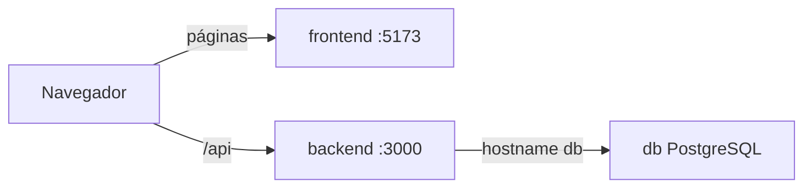

# FinTrack

Aplicación web de demostración para registrar ingresos y gastos en pesos colombianos. Muestra un tablero con los totales, un formulario para crear movimientos y una tabla para consultarlos o eliminarlos.

FinTrack no es un producto financiero. Su objetivo es que un estudiante pueda explicar, con un ejemplo pequeño, cómo se comunican tres contenedores Docker y cómo ese proyecto se versiona en GitHub.

## Objetivo académico

Demostrar:

- un repositorio con frontend, backend y base de datos separados;
- una API REST entre el navegador y el backend;
- PostgreSQL accesible solo desde la red de Docker;
- persistencia de datos en un volumen;
- el arranque completo con un solo comando.

## Tecnologías

- Frontend: React, Vite y TypeScript.
- Backend: Node.js, NestJS y TypeScript.
- ORM y migraciones: Prisma.
- Base de datos: PostgreSQL 16.
- Contenedores: Docker y Docker Compose.
- Moneda única: COP, guardada como `NUMERIC(18,2)`.

## Arquitectura

El navegador descarga la interfaz desde el contenedor `frontend` y llama la API en el puerto publicado del contenedor `backend`. El backend no usa `localhost` para la base de datos: usa el nombre del servicio `db`.

```text
Navegador
  |  http://localhost:5173
  v
frontend (React + Vite)
  ^
  |  el navegador llama http://localhost:3000/api
  v
backend (NestJS) ---- red Docker "fintrack" ----> db (PostgreSQL)
                                                      |
                                               volumen fintrack-db
```



PostgreSQL no publica ningún puerto en la máquina anfitriona. La explicación más detallada está en [docs/arquitectura.md](docs/arquitectura.md).

## Estructura

```text
fintrack-integracion-continua/
├── frontend/          React, Vite y su Dockerfile
├── backend/           NestJS, Prisma y su Dockerfile
├── docs/              Notas de arquitectura
├── evidencias/        Carpeta para capturas del informe
├── compose.yaml       Los tres servicios
├── .env.example       Valores locales de demostración
├── .gitignore
└── README.md
```

## Requisitos previos

- Docker con Docker Compose v2.
- Git, si se va a publicar el repositorio en GitHub.

No hace falta instalar Node.js ni PostgreSQL en la máquina para ejecutar la aplicación. Node.js solo se necesita si las pruebas unitarias se quieren correr fuera de Docker.

Los usuarios y contraseñas del archivo `.env.example` y de `compose.yaml` son de demostración. No deben reutilizarse en un entorno real.

## Iniciar y detener

Desde esta carpeta:

```bash
docker compose up --build -d
```

Ese comando construye las imágenes, crea la red `fintrack`, crea el volumen `fintrack-db`, aplica las migraciones de Prisma y deja los tres servicios en segundo plano.

Comprobar el estado:

```bash
docker compose ps
```

La interfaz queda en <http://localhost:5173> y la API en <http://localhost:3000>.

Ver los registros del backend, donde aparece la aplicación de migraciones:

```bash
docker compose logs backend
```

Detener los contenedores sin borrar los datos:

```bash
docker compose down
```

Volver a iniciarlos, reutilizando el volumen:

```bash
docker compose up -d
```

Borrar también la base de datos de demostración:

```bash
docker compose down -v
```

## Endpoints

Todas las rutas cuelgan de `/api`.

| Método | Ruta | Descripción |
| --- | --- | --- |
| `GET` | `/api/health` | Estado de la API y de la conexión con PostgreSQL |
| `GET` | `/api/transactions` | Movimientos, del más reciente al más antiguo |
| `POST` | `/api/transactions` | Crea un movimiento |
| `DELETE` | `/api/transactions/:id` | Elimina un movimiento |
| `GET` | `/api/summary` | Total de ingresos, gastos y balance |

Ejemplo de creación. El monto viaja como texto para no usar un número de punto flotante:

```bash
curl -s -X POST http://localhost:3000/api/transactions \
  -H 'Content-Type: application/json' \
  -d '{"description":"Salario","type":"INCOME","category":"Trabajo","amount":"2500000.00","date":"2026-11-10"}'
```

Los campos obligatorios son descripción, tipo, categoría, monto y fecha. El tipo solo puede ser `INCOME` o `EXPENSE`. El monto debe ser mayor que cero y tener como máximo dos decimales. Una petición inválida responde `400`. Si el movimiento a eliminar no existe, la API responde `404`.

`GET /api/summary` responde con textos decimales, por ejemplo:

```json
{"income":"2500000.00","expense":"85000.50","balance":"2414999.50"}
```

El balance es ingresos menos gastos. Puede ser negativo.

## Validar la comunicación entre servicios

1. Abrir <http://localhost:5173>. Debe verse el nombre FinTrack, tres tarjetas, el formulario y la tabla.
2. Consultar la API:

   ```bash
   curl -s http://localhost:3000/api/health
   ```

   Una respuesta correcta incluye `"database":"up"`. Eso confirma que el contenedor `backend` alcanzó al contenedor `db` por el nombre `db`.
3. Crear un ingreso y un gasto desde el formulario, o con `curl`. La tabla y las tarjetas deben actualizarse.
4. Comprobar que los tres contenedores comparten la red:

   ```bash
   docker network inspect fintrack --format '{{range .Containers}}{{.Name}} {{end}}'
   ```

   Deben aparecer `fintrack-frontend`, `fintrack-backend` y `fintrack-db`.
5. Leer la tabla desde el contenedor de PostgreSQL, sin abrir un puerto en el anfitrión:

   ```bash
   docker compose exec db psql -U fintrack -d fintrack -c 'SELECT id, description, type, amount, date FROM transactions ORDER BY date DESC;'
   ```

El navegador no llama a `http://backend:3000`. Ese nombre solo existe dentro de la red Docker. La URL configurada en el frontend es `http://localhost:3000`, que es el puerto publicado del backend.

## Comprobar la persistencia

1. Registrar al menos un movimiento.
2. Recrear los contenedores sin borrar volúmenes:

   ```bash
   docker compose down
   docker compose up -d
   ```

3. Abrir de nuevo la interfaz o consultar:

   ```bash
   curl -s http://localhost:3000/api/transactions
   ```

   El movimiento debe seguir ahí porque vive en el volumen `fintrack-db`.
4. `docker compose down -v` elimina ese volumen. Después de ese comando la tabla vuelve a quedar vacía.

## Pruebas

La prueba automática cubre el cálculo del resumen: suma de ingresos, suma de gastos, balance y el caso de los centavos. No necesita PostgreSQL.

Dentro del contenedor, cuando ya está en ejecución:

```bash
docker compose exec backend npm test
```

En una máquina con Node.js, desde `backend/`:

```bash
npm install
npm test
```

La prueba de la aplicación completa es manual y está descrita en las dos secciones anteriores: crear un ingreso, crear un gasto, revisar el balance, ver la tabla, eliminar un movimiento y reiniciar los contenedores.

## Evidencias recomendadas

Guardar las capturas en [evidencias/](evidencias/README.md):

1. Árbol del repositorio y enlace del repositorio en GitHub.
2. `compose.yaml`, con la red, el volumen y la URL `db`.
3. `docker compose ps` con los tres servicios en ejecución.
4. Inspección de la red `fintrack` con los tres contenedores.
5. Respuesta de `GET /api/health` con `"database":"up"`.
6. Pantalla de FinTrack en computador y en un ancho móvil.
7. Alta de un ingreso y de un gasto, con las tarjetas actualizadas.
8. Tabla de movimientos y eliminación de un registro.
9. La misma consulta después de `docker compose down` y `docker compose up -d`.
10. Resultado de `docker compose exec backend npm test`.
